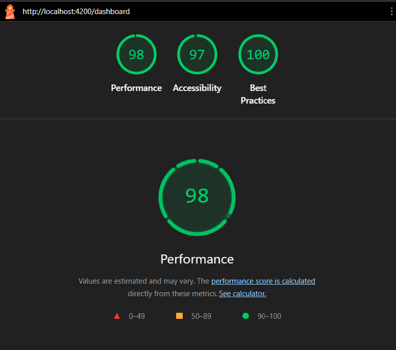
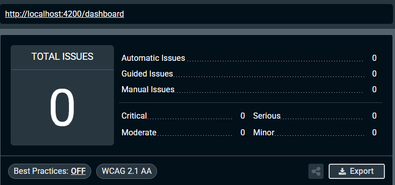

# Task Management Dashboard

[](https://github.com/Mohamed-khedrr/task-management-dashboard/actions/workflows/ci.yml)

A task board built with Angular 21 and PrimeNG. You can create, edit, delete, filter and search tasks, drag them between and within status columns, see live statistics and charts, manage the team, and use the app in English or Arabic (right to left).

**Live demo:** http://erzj3fkkplkzhtlpdif0ixr3.82.112.240.218.sslip.io/dashboard

The demo runs the Docker Compose setup below, with the same json-server mock API. Anyone can change the data, and it goes back to the original tasks when the server restarts.

## Contents

- [Features](#features)
- [Edge cases and details handled](#edge-cases-and-details-handled)
- [Tech stack](#tech-stack)
- [Getting started](#getting-started)
- [Environment configuration](#environment-configuration)
- [Scripts](#scripts)
- [Project structure](#project-structure)
- [Architecture decisions](#architecture-decisions)
- [State management](#state-management)
- [Forms](#forms)
- [Performance](#performance)
- [Accessibility and i18n](#accessibility-and-i18n)
- [Testing strategy](#testing-strategy)
- [Known limitations and future improvements](#known-limitations-and-future-improvements)

## Features

- **Dashboard:** four stat cards (total, completed, in progress, overdue), each with a change line such as "3 created this week". A board with To Do, In Progress and Done columns, and a toolbar with status tabs, priority and assignee filters and a search over titles and descriptions.
- **Drag and drop:** move a task to another column to change its status, or within a column to reorder it. The order is saved and survives a reload.
- **Tasks:** create and edit in a dialog (title, description, status, priority, due date, assignee, tags), and delete from the card's "⋮" menu after a confirmation.
- **Analytics:** tasks by status, by priority, overdue vs on track, overdue per person, and each person's tasks by status.
- **Team:** a card per member with their task counts per status and overdue, and an "Add member" dialog.
- **Activity:** recent task changes, also shown as the latest five in the header's notifications bell.
- **Settings:** your name (shown as initials in the header) and the language, both remembered.
- **Throughout:** a responsive layout with a drawer on small screens, skeletons while loading, error states with Retry, empty states, and translated error toasts.

## Edge cases and details handled

**Data the API gets wrong**

- `statistics.json` has fixed numbers that don't match the tasks, and the tasks' `isOverdue` field isn't reliable. The stat cards, overdue states and charts are all calculated from the task list instead, so they stay correct after every change.
- The mock data has no task order, so a task that was never moved is placed by its creation date. New tasks go to the bottom of their column.

**Long and missing content**

- Long assignee names in the toolbar's assignee filter are cut with an ellipsis and show in full in a tooltip. The tooltip only appears when the name is actually cut.
- Task titles in the Activity list and the notifications panel use the same rule, through one `appTruncate` directive. On the board, full titles are shown.
- Long task descriptions collapse to a few lines with a "Show more" / "Show less" toggle that tells screen readers whether it's expanded.
- The assignee filter and the form's assignee field are searchable. The filter can be cleared, shows "No assignees found" when nothing matches, and resets its search when it closes.
- When nothing changed this week, the stat cards say "No new tasks this week" instead of "+0".

**Empty and error states**

- **No tasks yet:** a message with a "New Task" button.
- **Filters that match nothing:** a message with "Clear filters".
- **Team and Activity:** their own empty and no-match messages.
- **A list that fails to load:** an inline error with a Retry button and no toast, so the error isn't shown twice. Failed saves, moves and deletes show a translated toast that says what went wrong (offline, not found, server error, and so on).
- **Creating a task when the list never loaded:** the "New Task" button in the sidebar still works. The new task isn't reported as a failure, and the list is loaded again instead of being updated.

**Requests and timing**

- **Retries:** loads, saves, moves and deletes retry twice on network errors, 408, 429 and 5xx. Creating a task or member (POST) is never retried, so a slow request can't create a duplicate.
- **Cache freshness:** the HTTP cache is cleared when a change starts and again when it finishes, so a list read while the change was in flight can't stay cached.
- **Moves:** a drag and drop shows at once and goes back if the server rejects it.
- **No double submits:** a save can't be sent twice; the button is disabled and shows a loader.
- **A deleted card** shows a spinner until the server confirms.
- **Switching language and saving:** the "Settings saved" toast waits for the new language file, so it never shows a raw translation key.

**Search**

- The header search follows the open page: it searches tasks, team members or activity, hides on pages with nothing to search, and clears when you navigate.
- Typing waits 300 ms before filtering; clearing applies at once.
- The activity list shows 30 entries at a time with "Show more".

**Team**

- A new member's email must be valid and not used by anyone on the team, ignoring capitals and spaces.
- Avatar initials come from the first and last words of the name. New members can be assigned tasks straight away.

**Loading the app**

- The font loads without blocking the first paint, and a small splash shows until Angular starts.

## Tech stack

| Area          | Choice                                     | Why                                                                                                   |
| ------------- | ------------------------------------------ | ----------------------------------------------------------------------------------------------------- |
| Framework     | Angular 21 (standalone, signals, zoneless) | Required. Signals and `httpResource` cover the app's state without a store library.                   |
| UI library    | PrimeNG 21 (Aura preset)                   | Ready-made dialog, select, menu, toast, drawer, popover and skeleton, themed with the Figma tokens.   |
| Charts        | Chart.js through PrimeNG `p-chart`         | Small, well known and already wrapped by PrimeNG. It's loaded only on the analytics page.             |
| Drag and drop | Angular CDK                                | Accessible, works with RTL, and needs no extra dependency.                                            |
| i18n          | Transloco                                  | Switches language at runtime without a rebuild. Angular's built-in i18n needs one build per language. |
| Mock API      | json-server                                | A real REST API with a delay, so loading and error states behave as they would in production.         |
| Tests         | Vitest (Angular's default runner), jsdom   | Fast, and runs through `ng test`.                                                                     |
| Tooling       | ESLint, Prettier, Husky, GitHub Actions    | Lint and format on commit, tests on push, and lint, tests with coverage and the build on every push.  |
| Deployment    | Docker Compose (nginx + json-server)       | One command runs the app and the API together, locally or on a server.                                |

## Getting started

Requirements: Node.js 20.19 or newer, and npm.

```bash
git clone https://github.com/Mohamed-khedrr/task-management-dashboard.git
cd task-management-dashboard
npm install
```

Run the mock API and the app in two terminals:

```bash
npm run mock:api   # http://localhost:3030
npm start          # http://localhost:4200
```

The data uses dates relative to today. To refresh the dates, run `npm run mock:data`.

### With Docker

```bash
docker compose up --build
```

The app is served by nginx on http://localhost:4200. The [Dockerfile](Dockerfile) has a stage for the app (built with Node, served by nginx, with every route falling back to `index.html`) and one for json-server. json-server has no port of its own: [nginx.conf](nginx.conf) forwards `/api/...` to it inside Docker, so the browser only talks to the app's address and there are no cross-origin requests.

## Environment configuration

The API address is set per build:

| File                                                                    | Used by                                                                         | `apiUrl`                   |
| ----------------------------------------------------------------------- | ------------------------------------------------------------------------------- | -------------------------- |
| [environment.ts](src/environments/environment.ts)                       | `npm start` and the tests                                                       | `http://localhost:3030`    |
| [environment.production.ts](src/environments/environment.production.ts) | `npm run build` and Docker (swapped in by `fileReplacements` in `angular.json`) | `/api`, forwarded by nginx |

Change `apiUrl` to point the app at another backend. json-server runs with a 1 second delay, so the loading states can be seen.

## Scripts

| Command                 | What it does                                              |
| ----------------------- | --------------------------------------------------------- |
| `npm start`             | Runs the dev server on port 4200                          |
| `npm run build`         | Builds for production into `dist/`                        |
| `npm test`              | Runs the unit tests with Vitest                           |
| `npm run test:coverage` | Runs the tests once with a coverage report in `coverage/` |
| `npm run lint`          | Lints the TypeScript and the templates                    |
| `npm run mock:api`      | Starts json-server on port 3030 with `mock-api/db.json`   |
| `npm run mock:data`     | Regenerates the mock data with dates relative to today    |

## Project structure

```
src/app
├── core/                 # App-wide code with no UI
│   ├── config/           # App name and logo
│   ├── i18n/             # Transloco setup, language service (RTL, saved language)
│   ├── interceptors/     # Cache, error toast, retry
│   ├── models/           # All interfaces and types
│   ├── services/         # Shared services: tasks, users, filters, search, dialog, profile, request cache
│   ├── theme/            # PrimeNG preset mapped to the design tokens
│   └── utils/            # Pure functions: dates, task ordering/filtering, statistics, activity
├── layout/               # Shell: header, notifications, sidebar, drawer, task dialog, toast
├── pages/                # One lazy-loaded folder per route
│   ├── dashboard/        # Stat cards, toolbar, board, columns, cards, task form
│   ├── analytics/        # Chart card, stacked bar card, legend
│   ├── activity/         # Recent task changes built from the task dates
│   ├── settings/
│   └── team/             # Member cards, Add member form
└── shared/               # Reusable UI helpers: truncate directive, form validators
src/styles/               # Design tokens (colors, spacing, type) from Figma
public/i18n/              # en.json, ar.json
mock-api/                 # db.json and the data generator
```

Some rules the structure follows:

- Shared services are in `core/services`. A service used by only one page goes in that page's folder.
- All models stay in `core/models`, even when only one page uses them, so types are always in one place.
- Logic that doesn't need Angular (ordering, filtering, statistics, dates) is in plain functions in `core/utils`. These functions are easy to test and to reuse between pages.

## Architecture decisions

### Data lives in shared root services

The task list and the user list each live in one service: `TaskService.tasks` and `UserService.users`. They're `httpResource`s, which hold the data as signals (`value()`, `isLoading()`, `error()`) and can `reload()` it. Both services use `providedIn: 'root'`, so the whole app shares a single instance of each.

Every part of the app that needs tasks or users injects the service and reads the same signal:

- the dashboard (stat cards and board);
- analytics;
- the activity page;
- the team page;
- the task dialog's assignee list;
- the notifications bell in the header.

Why this way:

- **One source of truth.** When a task is created, moved or deleted, the service updates its list, and every page that reads it updates too. There's no copy of the tasks inside a component that could go out of date.
- **No passing data from the top of the app.** Each smart component reads the service where it needs the data: the bell in the header and the task dialog in the layout get the lists themselves, instead of having them passed down from the shell. Below a smart component, data does go down through inputs to its presentational children (board → column → card, dialog → form), so those stay simple and easy to test.
- **Changes update the list in place.** After a create, edit or delete succeeds, the service puts the server's answer into its list. The list doesn't have to be fetched again.
- **No store library.** NgRx would add actions, reducers and effects to manage two lists. Root services with signals cover the same need with much less code, and `computed()` takes care of everything derived from the lists.

UI state that several components share follows the same pattern, in small root services: `TaskFiltersService` (search, status tab, priority, assignee), `TaskDialogService` (whether the dialog is open and which task it shows), `SearchService` (the header search) and `ProfileService` (your name and initials).

### Two layers of cache

Data is cached at two levels, and each covers a different case.

1. **The services (in the app's memory).** The lists stay in the root services while you move between pages. Opening the dashboard after the team page shows the tasks straight away, with no skeleton and no wait.
2. **The cache interceptor (in the HTTP layer)** ([cache-interceptor.ts](src/app/core/interceptors/cache-interceptor.ts), [request-cache.service.ts](src/app/core/services/request-cache.service.ts)). It keeps the response of every GET for 5 minutes, keyed by URL. Any POST, PUT or DELETE clears it, both when the change starts and when it finishes.

How the two work together:

- **Each page calls `reload()` when it opens,** so the data is never older than the cache allows.
- **Usually, that reload doesn't reach the server.** Within 5 minutes and with no change since, the interceptor answers from memory.
- **After a change, the next reload is fresh.** The service has already updated its list, and the cleared cache makes sure the next read comes from the server.
- **While a reload runs, the page keeps the data it has.** Skeletons only show on the very first load. Analytics is the exception: it waits for the reload, so the charts draw and animate once with the final data instead of twice.

### Errors and retries are handled once, in interceptors

Every request goes through three functional interceptors, registered in `app.config.ts` in this order:

```
request → cache → error → retry → server
```

- **Retry** ([retry-interceptor.ts](src/app/core/interceptors/retry-interceptor.ts)):
  - Opt in per request with `withRetry()`.
  - Retries twice, after 500 ms then 1 s.
  - Only for network errors, 408, 429 and 5xx, where trying again can help.
  - POST is never retried: a request that reached the server before failing would create the item twice.
- **Error** ([error-interceptor.ts](src/app/core/interceptors/error-interceptor.ts)):
  - Shows one translated toast for each kind of failure: offline, not allowed, not found, try again, server error.
  - Then rethrows the error, so the caller can still stop a loader or undo an optimistic change.
- **Cache**, as described above. A cached answer never reaches the other two.

Why this way:

- **The rules live in one place.** Services and components don't each need their own `catchError` or `retry`, and every failure looks the same to the user.
- **The order matters.** The error interceptor sits outside the retry interceptor, so it only sees an error once every retry has failed. A request that recovers on its second try shows no toast at all.
- **Per-request control through context tokens.** `withRetry()` turns retries on, and `SILENT_ERRORS` turns the toast off. The task and user list loads use `SILENT_ERRORS`, because those pages show their own error message with a Retry button, and a toast would say the same thing twice. Saves, moves and deletes keep the toast.

### Components

**Standalone components and lazy routes.** There are no NgModules. Every page is loaded with `loadComponent`, so its code, and libraries like Chart.js, only download when you open it.

**Smart and presentational components.** A few components own data and actions, and the rest only take inputs and emit outputs:

- `DashboardComponent` reads the tasks and filters and derives the columns and stats.
- `TaskBoardComponent` saves moves and runs edit and delete, with the confirm dialog. It's the smart part of the board, so events don't have to pass up through several layers.
- `TaskDialogComponent` creates and saves tasks; `TeamComponent` adds members.
- Presentational: `TaskColumnComponent`, `TaskCardComponent`, `TaskFormComponent`, `MemberFormComponent`, `StatCardComponent`, `TaskToolbarComponent`, and the chart cards.

**One dialog for the whole app.** The "New Task" button is in the sidebar and the edit action is on the cards, so the dialog lives in the layout. `TaskDialogService` holds whether it's open and which task it shows. The dialog is in an `@defer` block, so its code loads the first time it opens.

**Drag and drop saves one task.** A dropped task gets an `order` number halfway between the cards above and below it, so only that task is sent to the server. Renumbering the whole column would need one request per task, because json-server has no bulk update.

**Dependency injection.** Services use `providedIn: 'root'` and are injected with `inject()`. Services needed by one component tree only, such as `ConfirmationService` on the board, are provided at that component.

## State management

Signals cover all the state; the shared lists are described under [Data lives in shared root services](#data-lives-in-shared-root-services).

- **Derived state.** `computed()` builds the filtered tasks, the columns, the stats and the chart data. Grouping into columns is separate from the status tab, so switching tabs doesn't regroup every column.
- **Search debounce.** The search signal goes through RxJS (`toObservable` → `debounce` → `toSignal`).

Updates use two strategies:

- **Optimistic, for drag and drop.** The card moves at once and goes back if the request fails. Waiting for the server would make the card jump back for a second.
- **Wait for the server, for create, edit and delete.** These show a loader, and the list only changes when the server confirms. A new item needs the id from the server, and a failed save keeps the dialog open so you can try again.

## Forms

The task, Add member and settings forms are typed reactive forms (`NonNullableFormBuilder`).

- **Custom validators** ([form.validators.ts](src/app/shared/validators/form.validators.ts)):
  - `requiredText` rejects text that is only spaces, which `Validators.required` lets through.
  - `maxItemLength` limits the length of each tag, not the number of tags.
  - `notTaken` rejects an email someone on the team already has. It reads the list on every check, so it follows members added meanwhile.
- **Dynamic controls.** The same task form creates and edits. It fills in from the task being edited and starts fresh each time the dialog opens. Tags are a dynamic list, added with Enter or a comma.
- **Errors.** Each field shows its own message under it once it has been touched or the form has been submitted. Invalid inputs get `aria-invalid` and point to their message with `aria-describedby`.

## Performance

- `ChangeDetectionStrategy.OnPush` on every component, with signals for all state.
- Every `@for` loop has a `track` expression (`task.id`, `column.status`, and so on).
- Lazy routes, and `@defer` for the task dialog and the mobile drawer, which load only when first opened.
- Repeat requests are avoided by the [two cache layers](#two-layers-of-cache).
- No manual subscriptions that outlive a component. HTTP observables complete after one response, and the search debounce uses `toSignal`, which unsubscribes with the service.

**Lighthouse** (dashboard, run locally on http://localhost:4200):

| Category       | Score |
| -------------- | ----- |
| Performance    | 98    |
| Accessibility  | 97    |
| Best Practices | 100   |



## Accessibility and i18n

- Semantic landmarks (`header`, `nav`, `main`) and headings in order.
- All controls work with the keyboard, and focus is visible. Drag and drop has a keyboard alternative: the Status field in the edit dialog.
- Text and status colors meet WCAG AA contrast (4.5:1) on every background they're used on. The muted and status colors are a shade darker than in Figma for that reason. axe DevTools reports no issues on the dashboard.
- Each chart has an `aria-label` with its numbers in text, and an HTML legend with counts, so the data doesn't depend on color.
- Dialogs and menus manage focus: the delete confirmation focuses Cancel, so pressing Enter by accident doesn't delete, and closing the notifications panel returns focus to the bell.
- ESLint runs the angular-eslint template accessibility rules.
- **Arabic.** Choosing Arabic sets `dir="rtl"` and `lang` on `<html>`. The layout uses logical CSS properties, the charts flip their axes, and the drawer and toasts open from the other side. Relative times ("5 minutes ago") come from `Intl`, so they're translated too.



## Testing strategy

Tests use Vitest through `ng test`, and sit next to the code as `*.spec.ts` files.

- **Pure functions** (`core/utils`) are tested directly with small task fixtures and a fixed "today", so the date logic is predictable.
- **Services** are tested with `HttpTestingController`: the requests sent, the list updates, and the rollback when an optimistic update fails.
- **Interceptors** are tested with a real `HttpClient` and fake timers, for retry counts, delays and the methods that must not be retried.
- **Components** are tested through their DOM, the way a user sees them: what renders, what happens on click or submit, and what's emitted.
- Tests check behavior, not labels or static markup, so changing text or styles doesn't break them.

Coverage is checked against an 80% minimum for statements, branches, functions and lines (set in `angular.json`), and CI fails if it drops below that. It's currently about 94% of statements and 93% of branches.

## Known limitations and future improvements

**Limitations**

- **The activity feed is derived.** The backend has no change log, so the Activity page and the notifications bell build their entries from each task's created, updated and completed dates. They show that a task changed, not what changed or who changed it.
- **Order numbers can run out of room.** After very many drops in exactly the same spot, the numbers between two cards get too close together.
- **The initial bundle is over budget.** The first load is about 728 kB (about 175 kB compressed), above the 500 kB warning budget in `angular.json`. The build still passes, since the error limit is 1 MB.
- **Demo data isn't permanent.** json-server keeps changes in its file only until the server restarts.

**Future improvements**

- Record task changes on the server and show real history in the activity feed and notifications.
- Renumber a column on the server when its order numbers get too close together.
- Shrink the first load by including only the PrimeNG theme parts the app uses, and loading the translations on demand.
